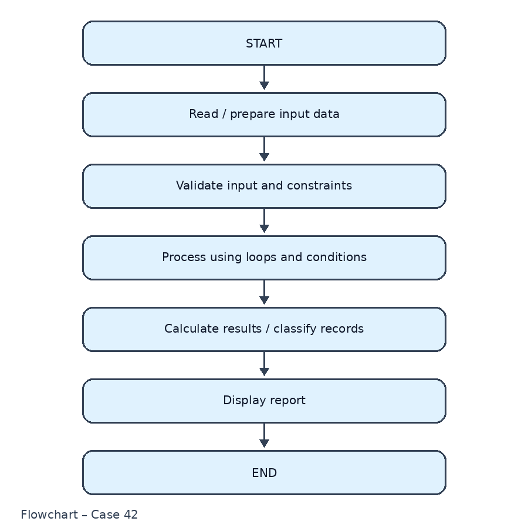
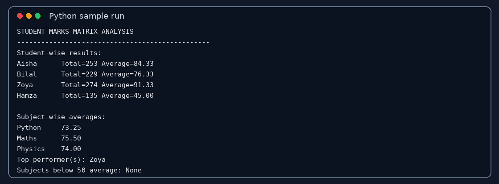

# Case Study 42: Student Marks Matrix Analysis

## 1. Problem Statement
Analyse a matrix of student marks across subjects, calculate row-wise and column-wise statistics, identify top performers, and detect subjects with low average performance.

## 2. Objectives
- Represent marks using a nested list.
- Calculate each student's total and average.
- Calculate subject averages and identify low-performing subjects.
- Identify the top-performing student.

## 3. Assumptions
- Each row represents one student and each column represents one subject.
- All marks are between 0 and 100.
- A subject is flagged when its class average is below 50.
- The student with the highest average is the top performer; ties are reported.

## 4. Algorithm
1. Store student names, subject names, and the marks matrix.
2. Validate matrix dimensions and mark ranges.
3. Calculate row totals and averages for students.
4. Calculate column totals and averages for subjects.
5. Find the highest student average and all ties.
6. Identify subjects with average below 50.
7. Display the analysis.

## 5. Flowchart
The diagram below shows the overall program flow. Detailed case-specific decisions are implemented in `solution.py`.



## 6. Pseudocode
```text
START
READ student names, subject names, marks matrix
VALIDATE dimensions and mark range
FOR each student row
  CALCULATE row total and average
END FOR
FOR each subject column
  SUM marks from every student row
  CALCULATE subject average
  IF average < 50, flag subject
END FOR
FIND maximum student average and matching names
DISPLAY student and subject statistics
STOP
```

## 7. Python Source Code
See [`solution.py`](solution.py). The program uses Python built-in features and no third-party packages.

## 8. Test Cases

| Test | Input / condition | Expected result |
|---|---|---|
| Normal matrix | Four students and three subjects as in sample | Zoya is top performer; all subject averages calculated |
| Low subject average | Column values [30, 40, 45] | Subject is flagged below 50 |
| Tie for top | Two students have equal highest averages | Both names appear in toppers |
| Invalid mark | A score of 105 | ValueError is raised |
| Wrong matrix width | A row has fewer subject scores | ValueError is raised |

## Sample Output
The included program was run with the sample data in `main()`. The captured output is also saved as `sample_output.txt`.



## 9. Output Screenshot
This terminal-style screenshot is a generated capture of the sample program output. Run `python solution.py` to reproduce it.

## 10. Conclusion
The program performs row-wise and column-wise analysis on a nested list, identifies top performers, and detects weak subjects using nested loops and list operations.
